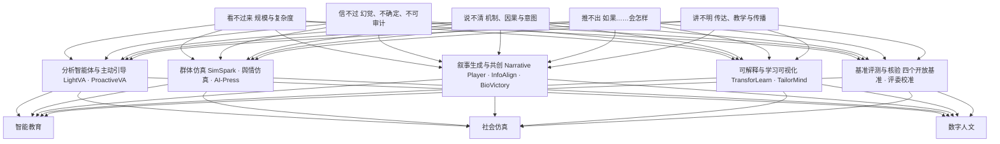
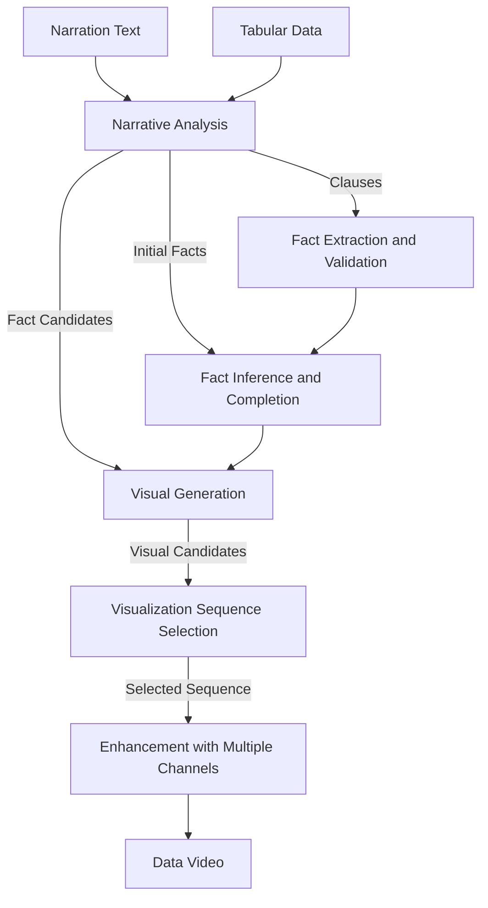
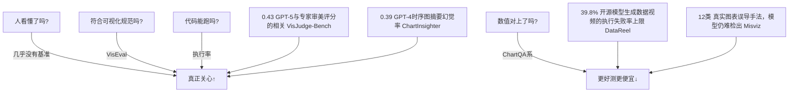

# 《课堂分享.pdf》可识别文字解析与可阅读纪要

> 整理日期：2026-11-21  
> 来源文件：《课堂分享.pdf》  
> 说明：本文件先把 PDF 中可识别文字按主题与原样解析整理出来，再组织为可阅读纪要。原文中的拼写错误、截断词、OCR 异常均按资料原样保留，不作擅自补全；无法确认的逐字内容未补写。

---

## 0. 资料边界说明

这份 PDF 的文字解析由两类内容组成：

1. **幻灯片正文文字**：可直接读出课程主题、会议背景、四大模块、方法名称与核心观点。
2. **图片内文字**：包括 LightVA 界面、ProactiveVA 界面、Titanic 信息图、GDP 数据表、SimSpark 界面、CohortVA 论文页、TailorMind 学习路径页等。部分图片文字由 OCR 解析得到，存在拼写错误和截断。

本纪要中，凡是原文可见的关键句、标题和图表标签，尽量保留英文原样；对明显只有片段、无法确认完整含义的内容，标记为“可识别文字片段”。

---

# 第一部分：可识别文字解析

## 1. 封面与会议背景

### 1.1 课程与讲者信息

可识别文字：

- 信息图表可视化 · 课堂分享
- 智能可视分析与数据叙事
- 陈思明教程选讲
- 另谈 jk-Plots：统计图怎样表达不确定性
- TUTORIAL · 90 分W
- 智能可视分析与数据叙事
- 方法·评测·应用
- 理论·拆解·案例·可带走的方法
- 陈思明
- 复旦大学大数据学院·可视分析与智能决策实验室
- FDUWS·复旦大学用械分析与智能决策实验室
- iQQQ Neo11
- 2020-10-09-01

> 注：“90 分W”“用械分析”“iQQQ Neo11”等为可识别文字中的原始异常写法，未作改写。

### 1.2 IEEE VIS 背景

可识别文字：

- 会议背景
- IEEE VIS：可视化领域的国际顶级会议
- IEEE Visualization Conference
- CCF A 类
- 中国计算机学会推荐
- 国际学术会议
- 录用后进入 TVCG 专刊
- TVCG 为 CCF A 类期刊
- 02

### 1.3 CSIG 讲习班背景

可识别文字：

- 会议背景
- CSIG 图像图形学科前沿讲习班
- 国家一级学会主办的专题学术研修
- 主办：中国图像图形学会（CSIG）
- 本期主题
- 智能时代的大数据可视化与人机协同

---

## 2. 教程结构：四类问题

可识别文字：

- 陈思明教程
- 教程中的四类问题

### 2.1 分析

- 分析
- 下一步查什么？
- LightVA、ProactiveVA

### 2.2 叙事

- 叙事
- 资料怎样讲清楚？
- InfoAlign、Narrative Player

### 2.3 评测

- 评测
- 图对不对，读者懂不懂？
- “信达雅”的细化

### 2.4 应用

- 应用
- 具体领域需要什么？
- 教育、社会仿真、人文历史

---

## 3. 总览图：从问题到方法再到应用

可识别文字中包含一段 Mermaid 关系图文本：



相关可识别文字：

- 《课堂分享.pdf》
- 应用·智能教育
- TailorMind：知识关系与学习路径放在一起
- 概念怎样关联
- 应用
- 用得好
- 同一套方法，落到课堂、档案馆和舆论场，变了什么？
- 拆解框架
- 智能教育
- 社会仿真
- 数字人文
- 模块四 · 应用
- 应用的思考逻辑：问题 → 方法 → 领域
- 线宽 = 支撑工作的多少
- 共性问题
- 《课堂分享.pdf》

---

## 4. 模块一：分析

## 4.1 LightVA

可识别文字：

- 分析
- LightVA：把大目标拆成可检查的任务
- 推荐任务，执行分析，再检查目标是否得到回答。

图片内可识别文字：

- 模块一·智能可视分析·③ LightVA
- LightVA：四个视图
- Task Retracing
- Task Flow
- D
- B Visual Exploration
- i VISUALIZATION VIEW
- 2. Analyze the sediment of messages over time to identify any significant changes.
- 3. Conflict a frequency analysis of keywords within the messages.
- Top 8008 Forment Keywords in Mlo
- 4. Forment Keywords in Mlo
- 5. Forment Keywords in Mlo
- 6. Forment Keywords in Mlo
- 7. Forment Keywords in Mlo
- 8. Forment Keywords in Mlo
- 9. Forment Keywords in Mlo
- 10

> 注：上述英文中出现 “Conflict”“Forment”“Mlo”等异常写法，按可识别文字保留。

## 4.2 ProactiveVA

可识别文字：

- 分析
- ProactiveVA
- 等待用户提问
- 用户可能不知道该问什么
- 观察交互，再提出建议
- 是否采用，仍由用户决定
- ProactiveVA · 作者视频
- 建议、原始数据与笔记放在一起
- 模块三·智能评测

图片/表格内可识别文字：

- ORIGINAL VA SYSTEM
- Off
- Obloading Dn
- Off
- Exploration Dn
- Off
- Summaris Dn
- A worked for a minutes ▼Read message data from hexagonsThe user has selected a time range and filtered messages from two different hexagons. To further assist, I should read the message data from these hexagons to identify any high-risk messages or entities involved. Additionally, I can highlight key nodes in the Graph view to show relationships between entities in these messages.
- mbdata/cdata
- mbdata
- 20:05:00sofites: isevacuating us #APD#standoff
- Sentiment
- C
- Notes...
- All submit
- 17:05:00
- 17:12:20
- 7:21:40
- 17:30:00
- 17:38:20
- 17:46:40
- 17:55:00
- 18:03:20
- 18:11:40
- 18:20:00
- 18:28:00
- 18:36:40
- 18:45:00
- 18:53:20
- 19:01:40
- 19:10:00
- 19:18

另有一张对比示意图中的可识别文字：

- Interaction sequence
- (a) Traditional Visual Analytics: Users analyze data solely
- help needed
- Can you help me compare the sales trend of two products?
- Yes, I will examine the data and analyze it.
- (b) Reactive AI-assisted Visual Analytics: Only responds when user inquires
- Interaction sequence
- help needed
- monitor
- It seems like you're having trouble when analyzing sales of different products, would you like me to explore it for you?
- Yes, please try it!
- (c) Proactive AI-assisted Visual Analytics: Detects user struggles and offers help

---

## 5. 模块二：叙事

## 5.1 总体问题与结构

可识别文字：

- 智能故事叙述
- 放映时点击画面播放·约1分50秒
- 用户操作
- 建议出现
- 确认后执行
- 02
- 智能故事叙述
- 讲得清
- 如何让 AI 把数据讲成故事，又不“编”故事？
- 叙事三层
- 表达设计空间
- Narrative Player
- InfoAlign
- 叙事

## 5.2 Narrative Player

可识别文字：

- 叙述说到哪里
- 画面就强调哪里
- Narrative Player · GDP 视频
- 比较多国趋势时，画面怎样转移重点
- Narrative Player：让画面跟上叙述
- Rainfall plays its part, especially in May and June,
- 放映时点击画面播放·天气案例约54秒
- 单国随时间变化
- 多国趋势比较

流程图文本：



GDP 表格可识别文字：

| Year | United States | China | Japan | Germany | India |
|:---:|:---:|:---:|:---:|:---:|:---:|
| 2007 | 14.5 | 3.5 | 4.8 | 3.3 | 1.2 |
| 2008 | 14.8 | 4.5 | 5.0 | 3.7 | 1.3 |
| 2009 | 14.5 | 5.0 | 5.1 | 3.4 | 1.4 |
| 2010 | 15.5 | 6.5 | 5.7 | 3.4 | 1.6 |
| 2011 | 16.0 | 8.0 | 6.2 | 3.4 | 1.7 |
| 2012 | 16.5 | 9.0 | 6.2 | 3.5 | 1.8 |
| 2013 | 17.0 | 9.5 | 5.2 | 3.3 | 1.9 |
| 2014 | 17.5 | 10.5 | 4.8 | 3.4 | 2.0 |
| 2015 | 18.0 | 11.0 | 4.5 | 3.3 | 2.1 |
| 2016 | 18.5 | 11.5 | 4.8 | 3.4 | 2.2 |
| 2017 | 19.5 | 13.0 | 4.9 | 3.5 | 2.3 |
| 2018 | 20.5 | 14.0 | 5.0 | 3.6 | 2.4 |
| 2019 | 21.5 | 14.5 | 5.0 | 3.7 | 2.5 |
| 2020 | 21.0 | 15.0 | 5.0 | 3.6 | 2.6 |
| 2021 | 23.0 | 18.0 | 4.9 | 3.7 | 2.7 |
| 2022 | 25.0 | 18.0 | 4.8 | 3.6 | 2.8 |

- GDP：轴标题

## 5.3 InfoAlign

可识别文字：

- InfoAlign：把长文本组织成信息图
- Tragedy on the Wave
- 讲什么
- 用什么表达
- 怎样排在一页
- InfoAlign
- 创作分成三个可以修改的决定
- 组织内容
- 长文本拆成片段单元
- 选择视觉表达
- 图表、图标与强调
- 安排版面
- 层次与阅读顺序
- InfoAlign
- 生成以后，内容与版面都能改
- 不同题材，怎样安排信息层次
- 作者演示视频（联网打开）
- InfoAlign · 作者生成案例

Story Unit 图片内可识别文字：

- Story Unit 2:
- H1 H2 Icon
- 43% of Second Class passengers survived.
- Icon Keyword:
- Icon of 2
- Chart:
- Story Unit 3:
- H1 H2 Icon
- 25.5% of Third Class passengers survived.
- Icon Keyword:
- Icon of 3
- Chart:
- X

Gender 图片内可识别文字：

- Gender
- 339
- 446
- women onboard
- 339 women survived out of 446 onboard.
- 73% of women survived compared to 19% of men.
- men
- women

Titanic 流程/案例图内可识别文字：

- A
- What are the factors that influenced the survival rate on the Titanic?
- Upload
- B
- 61.9% of First Class passengers survived.
- Icon Keyword: Chart:
- Icon of 1
- Story Unit 2: H1 H2 Icon
- 43% of Second Class passengers survived.
- Icon Keyword: Chart:
- Icon of 2
- Story Unit 3: H1 H2 Icon
- 25.5% of Third Class passengers survived.
- Icon Keyword: Chart:
- Icon of 3
- Story Piece 3
- Example
- subtitle:
- Influence of gender on survival rates
- Story Unit 1: H1 H2 Icon
- 339 women survived out of 466 onboard.
- Icon Keyword: Chart:
- female
- Similarity
- E
- Tragedy on the Wave
- Titanic Tragedy
- 1,317 passengers
- 2000
- Titanic
- 705 people survived.
- Class
- 61.9% of First Class passengers survived.
- 11
- 43%
- of Second Class passengers survived.
- 22
- 25.5%
- of Third Class passengers survived.
- 3
- Gender
- 339
- 339 women
- survived out of
- 446 onboard.
- 73% of women
- survived compared to
- 19% of men.

Titanic 信息图内可识别文字：

- Tragedy on the Wave
- Titanic Tragedy
- 1,317 passengers aboard the Titanic.
- 705 people survived.
- Class
- 61.9% of First Class passengers survided.
- 11
- 43% of Second Class passengers survided.
- 22
- 25.5% of Third Class passengers survided.
- 3
- Age
- Oldest person was 80 years old
- Gender
- 446
- 339
- 339 women survided out of 446 onboard.
- 73% of women survided compared to 19% of men.
- men
- women
- Family presence
- Youngest person was just a few months.
- Presence of more family members improved chance of survival

还有一页可识别文字片段：

- women
- Family presence
- Presence of more family members improved chance of survival
- Younggest person was just a few months
- Yougent person was just a few months
- E1
- T

Dark Energy 案例可识别文字：

- Understanding Dark Energy
- Definition of dark energy
- Dark energy
- accelerate the expansion of the universe.
- Dark energy in universe
- 70% of the energy in the cosmos is dark energy.
- Current understanding of dark energy
- Historical context of dark energy discovery
- Dark energy may even be weakening over time.
- Dark energy wasn't discovered until the late 1990s
- Theories about dark energy
- Future of dark energy
- Theories about dark energy include vacuum energy, quintessence, space wrinkles, and flaws in general relativity.
- Theoium Energy Quithicence
- Figure on dark energy will provide detailed information about changes over time.

---

## 6. 模块三：智能评测

可识别文字：

- 03 智能评测
- 评得准
- 生成越来越便宜，
- 评判怎样不滑向“好测但不重要”？
- 构念滑移 信·达·雅 五环翻译链 开放基准
- FDUVIS·复旦大学可视分析与智能决策实验室
- 模块三·智能评测
- 《课堂分享.pdf》
- 为什么要评测：构念在悄悄滑移

构念滑移流程图文本：



问题陈述可识别文字：

- 问题
- 基准在悄悄从“人看懂了吗”滑向“数值对上了吗”——更好测，但不是最重要的；我们用信·达·雅把评判拉回到人

五环 × 三粒度覆盖图可识别文字：

- 模块三·智能评测
- 覆盖图：五环 × 三粒度
- 现有基准落在哪里，空白在哪里

```mermaid
graph TD
    A1[数据之信] --> A2[ChartQA系·VisEval·ChartInsighter]
    A1 --> A3[ChartHal]
    A1 --> A4[DashArena执行证据]
    A5[表达之信] --> A6[Misviz误导手法]
    A5 --> A7[ChartAnno强调·ChartFI锐度]
    A5 --> A8[空白]
    A9[足] --> A10[空白]
    A9 --> A11[空白]
    A9 --> A12[空白]
    A13[达] --> A14[DVBench(模型在读)]
    A13 --> A15[空白(顺序·节奏)]
    A13 --> A16[人因实验(以访谈、量表为主)]
    A17[雅] --> A18[空白]
    A17 --> A19[空白]
    A17 --> A20[VisJudge-Bench·成对]
```

- □ 我们的工作
- [ ] 空白
- 机会
- “足”整行空白；表达之信、达、雅的元素与关系层几乎没人做——覆盖图里的空白，就是下一个基准
- FDUVIS·复旦大学可视分析与智能决策实验室

---

## 7. 模块四：应用

## 7.1 应用总览

可识别文字：

- 04
- 应用
- 应用的思考逻辑：问题 → 方法 → 领域
- 线宽 = 支撑工作的多少
- 同一套方法，落到课堂、档案馆和舆论场，变了什么？

## 7.2 智能教育：TailorMind / TransforLearn

可识别文字：

- 应用·智能教育
- TailorMind：知识关系与学习路径放在一起
- 概念怎样关联
- 学习走到哪一步
- 对照原文，检查与修改

TailorMind/学习路径图可识别文字：

- LEARNING PATH
- F
- Reset
- Edit
- Submit
- Milestone-1
- Multi-head Self-Attention
- Milestone-2
- Positional Encoding
- Milestone-3
- Layer Normalization and Residual Connections
- Milestone-5
- Transformer Encoder and Decoder
- Extended
- Contrast
- Related
- Significance
- Implementation
- Application
- Principle
- Concept
- Functionality
- Key-Query-Value
- Categories
- Milestone-0
- Introduction to Transformers

## 7.3 社会仿真：SimSpark

可识别文字：

- 应用·社会仿真
- SimSpark：改变情境，观察模拟人物的反应

SimSpark 界面可识别文字：

- SIMSPARK
- Start Time 2018-02-12 00:00:00
- End Time 2018-02-19 23:59:59
- Interval 3600
- Recommend
- 1 10
- 2018-2-12
- 2018-2-20
- All
- 1
- 10
- -
- 8
- +
- Daily Life
- Social Media
- 2018-2-12
- 2018-2-13
- 2018-2-14
- 2018-2-15
- 2018-2-16
- D
- D
- 0
- analyzing marker
- starting to write
- taking a nap and reading to invest
- 1
- waking up and c
- spark
- 2
- spending time w
- waking up and c
- 3
- sleeping
- working on his p
- coding software
- working on her a reading and jour
- 4

## 7.4 人文历史：CohortVA

可识别文字：

- 人文历史·作者视频
- CohortVA：作者怎样演示群体分析
- VIS2022
- Visual Analytics and Intelligence Group
- CohortVA:
- A Visual Analytic System for Iterative Exploration of Cohorts based on Historical Data
- Wei Zhang, Jason K. Wong, Xumeng Wang, Youcheng Gong, Rongchen Zhu, Kai Liu, Zihan Yan, Siwei Tan, Huamin Qu, Siming Chen, Wei Chen
- State Key Lab of CAD&CG, Zhejiang University
- Laboratory of Art and Archaeology Image, Ministry of Education
- Hong Kong University of Science and Technology
- TMCC, CS, Nankai University
- Fudan University
- 重点看
- 系统提出候选群体，历史学者逐步核对与调整。

界面/图表可识别文字片段：

- gs)
- 364
- e E(Neo-Confucian thinker(lxue))
- 568
- Update
- 275
- Export
- C2 Figure Feature Validation
- Figure Feature number
- Figure Label all
- C2-1
- 1 20 100
- 30
- C2-2
- 20
- Zhu Xi
- Lv Zuqian
- Lou Yue
- Liu Zai
- Fan Zhongyan
- Zhang Shi
- Zhen Dexiu
- Yang Shi
- Lu Jiuyuan
- Zhao Ruyu
- Cao Yanyue
- Huang Gan
- Li Guang
- Liu Gong
- Zhang Jiucheng
- Xin Oji
- Hu Anguo
- Sun Yingshi
- Liu Qingzhi
- Peng Guinian
- Event Map
- Event number
- C3-4
- Fujian Lu
- Fujian Lu
- C3-5
- Event Timeline
- m 1,600
- 1,400
- 1,000
- 1,000
- 800
- 600
- 400
- 200
- 0
- 1145
- 1150-11
- C3-12
- C3-13
- C3-14
- C3-15
- C3-16
- C3-17
- C3-18
- C3-1
- C
- 100%
- 830%
- -40%
- -50%
- -60%
- -70%
- -80%
- -90%
- -10

---

## 8. 零散案例页：Mental Health Facts 与 Water

## 8.1 Mental Health Facts

可识别文字：

- Mental Health Facts
- Prevalence of mental illness in the U.S.
- Impact of mental health on suicide rates.
- Age of onset for mental illness.
- Treatment-seeking behavior among mental illness.
- Public perceptions
- Mental health awareness.
- increased public knowledge
- 26% of US adults experience mental illness each year.
- 90%
- Half of all chronic mental illness begins by age 14.
- 50% of people suffering from mental illnesses do not seek treatment.
- 39% would view someone differently if they knew of their mental illness.
- 33% agreed with the statement 'people with mental health disorders care me'.
- Better knowledge about different types of mental illness reduces discriminatory views.
- 26%
- 90% of Americans who die by suicide have experienced symptoms of a treatable mental health condition.
- 75% of chronic mental illness begins by age 24.
- It takes on average 11 years for someone to seek help after first experiencing symptoms.
- 1 in 20 US adults live with a serious mental illness.
- SuCIDE
- 5%
- It takes on average 11 years for someone to seek help after first experiencing symptoms.

> 注：表格结构在资源中以转义 HTML 标签形式呈现，行列对应关系无法完全确认；以上按可识别文字逐条列出。

## 8.2 Water

可识别文字：

- 水（Water）
- Why and How Is it Important
- Importance of addressing water insecurity: climate change is the critical challenge of our time. Addressing water insecurity is equally important.
- Consequences of low public understanding of water security: 47% said addressing water security was as important as addressing climate change.
- Global water use escalation and challenges:
- Annual water use rose by around 3,500 billion m³ globally.
- One in six said it was common to hear politicians talk about water security.
- Global water demand is projected to grow by 400 billion m³ annually.
- Disconnect between public confidence and water scarcity awareness.
- Examples to address water insecurity:
- 74% claimed to be confident in their country's freshwater supply.
- smart meters are reducing leakage in the UK
- 85% in India and 74% overall cited drought as an issue.
- hydroponic agriculture is transforming food production.
- Collective effort in water security: supply of fresh water meets growing demand

---

# 第二部分：可阅读纪要

## 1. 分享主题与定位

本次分享的主题是**智能可视分析与数据叙事**，副标题为**方法·评测·应用**。课程定位为 90 分钟教程，强调“理论·拆解·案例·可带走的方法”。主讲人为陈思明，来自复旦大学大数据学院·可视分析与智能决策实验室。[pdf_1]

分享背景包括两个会议/培训场景：一是 IEEE VIS，即可视化领域国际顶级会议，资料中标注其为 CCF A 类会议，录用后进入 TVCG 专刊；二是 CSIG 图像图形学科前沿讲习班，由国家一级学会中国图像图形学会主办，本期主题为“智能时代的大数据可视化与人机协同”。[pdf_1]

---

## 2. 分享的核心问题意识

整场分享围绕四类问题展开：

1. **分析**：下一步查什么？对应 LightVA、ProactiveVA。
2. **叙事**：资料怎样讲清楚？对应 InfoAlign、Narrative Player。
3. **评测**：图对不对，读者懂不懂？对应“信达雅”的细化。
4. **应用**：具体领域需要什么？对应教育、社会仿真、人文历史。[pdf_1]

资料中的总览图进一步把这些方法放在几类共性问题下：看不过来（规模与复杂度）、信不过（幻觉、不确定、不可审计）、说不清（机制、因果与意图）、推不出（如果……会怎样）、讲不明（传达、教学与传播）。这些问题共同指向分析智能体、群体仿真、叙事生成、可解释学习可视化和基准评测等方向，并落到智能教育、社会仿真、数字人文三大应用领域。[pdf_1]

---

## 3. 模块一：分析——从“看不过来”到可检查的任务

### 3.1 LightVA：把大目标拆成任务

LightVA 的核心是“把大目标拆成可检查的任务”。资料给出的界面包含四个视图/模块：Task Retracing、Task Flow、Visual Exploration 等，并在正文里概括为：推荐任务，执行分析，再检查目标是否得到回答。[pdf_1]

从可识别界面文字看，LightVA 的任务示例包括：“Analyze the sediment of messages over time to identify any significant changes.”以及与关键词频率分析相关的步骤。虽然界面 OCR 存在不少异常词，但可以看出其目标是把分析过程显式化，让每一步任务和建议都可追踪、可回看。[pdf_1]

### 3.2 ProactiveVA：从被动响应到主动建议

ProactiveVA 的讨论起点是：传统系统等待用户提问，但用户可能不知道该问什么。资料给出的策略是：观察交互，再提出建议；是否采用，仍由用户决定。[pdf_1]

可识别图示把智能辅助可视分析分为三类：传统可视分析中用户独自分析；反应式 AI 辅助中用户询问后系统才响应；主动式 AI 辅助中系统检测用户困难并主动提供帮助。示例对话包括用户询问“Can you help me compare the sales trend of two products?”，以及系统主动提示“It seems like you're having trouble when analyzing sales of different products, would you like me to explore it for you?”。[pdf_1]

ProactiveVA 的实际界面强调把“建议、原始数据与笔记放在一起”。资料中可识别的建议文本是：用户选择了一个时间范围并过滤了两个不同六边形中的消息，系统据此建议读取这些六边形中的消息数据，以识别高风险消息或相关实体，并在 Graph view 中高亮关键节点来展示实体关系。[pdf_1]

---

## 4. 模块二：叙事——让画面跟上叙述

### 4.1 核心问题

叙事模块围绕“如何让 AI 把数据讲成故事，又不‘编’故事？”展开。资料中给出叙事三层、表达设计空间，以及两个代表方法：Narrative Player 和 InfoAlign。[pdf_1]

### 4.2 Narrative Player：叙述说到哪里，画面强调哪里

Narrative Player 的口号是：“叙述说到哪里，画面就强调哪里。”资料中给出的流程是：输入 Narration Text 与 Tabular Data，经过 Narrative Analysis，生成 Clauses、Initial Facts 和 Fact Candidates；随后进入 Fact Extraction and Validation、Fact Inference and Completion，再生成 Visual Candidates，经过 Visualization Sequence Selection 和 Enhancement with Multiple Channels，最终生成 Data Video。[pdf_1]

案例包括 GDP 视频，讨论“比较多国趋势时，画面怎样转移重点”，以及天气案例，页面提示“放映时点击画面播放·天气案例约54秒”，可识别旁白为“Rainfall plays its part, especially in May and June,”。[pdf_1]

GDP 数据表包含 United States、China、Japan、Germany、India 五国从 2007 到 2022 年的数值，例如 2007 年分别为 14.5、3.5、4.8、3.3、1.2，2022 年分别为 25.0、18.0、4.8、3.6、2.8。资料标注“GDP：轴标题”，说明这是用于视频叙事演示的数据表。[pdf_1]

### 4.3 InfoAlign：把长文本组织成信息图

InfoAlign 聚焦“把长文本组织成信息图”。资料把创作拆成三个可以修改的决定：**讲什么、用什么表达、怎样排在一页**。对应步骤包括：组织内容、长文本拆成片段单元、选择视觉表达、图表/图标与强调、安排版面、层次与阅读顺序。最后强调“生成以后，内容与版面都能改”。[pdf_1]

InfoAlign 的案例是 Titanic 信息图“Tragedy on the Wave”。流程图中出现的问题是“What are the factors that influenced the survival rate on the Titanic?”，随后系统将内容拆成 Story Unit，例如：“43% of Second Class passengers survived.”、“25.5% of Third Class passengers survived.”，并为每个 Story Unit 安排 Icon Keyword、Icon 和 Chart。[pdf_1]

最终信息图中可识别内容包括：

- Titanic Tragedy
- 1,317 passengers aboard the Titanic.
- 705 people survived.
- Class：61.9% of First Class passengers survided；43% of Second Class passengers survided；25.5% of Third Class passengers survided。
- Age：Oldest person was 80 years old。
- Gender：339 women survided out of 446 onboard；73% of women survided compared to 19% of men。
- Family presence：Youngest person was just a few months；Presence of more family members improved chance of survival。[pdf_1]

资料中还包含 Dark Energy 案例，讨论“不同题材，怎样安排信息层次”。可识别内容包括暗能量定义、宇宙中 70% 的能量是暗能量、暗能量可能在随时间减弱、直到 1990 年代后期才被发现，以及相关理论如 vacuum energy、quintessence、space wrinkles、flaws in general relativity 等。[pdf_1]

---

## 5. 模块三：评测——别让基准滑向“好测但不重要”

评测模块的核心是：生成越来越便宜，评判怎样不滑向“好测但不重要”。资料指出，基准正在从“人看懂了吗？”悄悄滑向“数值对上了吗？”，后者更好测、更便宜，但不是最重要的。[pdf_1]

资料列出的几个数字包括：

- 0.43：GPT-5 与专家审美评分的相关，来自 VisJudge-Bench。
- 0.39：GPT-4 时序图摘要幻觉率，来自 ChartInsighter。
- 39.8%：开源模型生成数据视频的执行失败率上限，来自 DataReel。
- 12 类：真实图表误导手法，模型仍难检出，来自 Misviz。[pdf_1]

评测框架使用“信·达·雅”的五环翻译链：数据之信、表达之信、足、达、雅。覆盖图显示，数据之信已有 ChartQA 系、VisEval、ChartInsighter、ChartHal、DashArena 执行证据等；表达之信涉及 Misviz、ChartAnno、ChartFI；达涉及 DVBench 和人因实验；雅涉及 VisJudge-Bench 等。但“足”整行是空白，表达之信、达、雅的元素与关系层也几乎没人做。资料明确写道：“覆盖图里的空白，就是下一个基准”。[pdf_1]

---

## 6. 模块四：应用——同一套方法落到三个领域

### 6.1 智能教育：知识关系与学习路径放在一起

智能教育案例中，TailorMind 的任务是把知识关系与学习路径放在一起，关注“概念怎样关联”和“学习走到哪一步”。[pdf_1]

学习路径图中出现 Milestone-0 到 Milestone-5 的学习节点，包括：

- Introduction to Transformers
- Multi-head Self-Attention
- Positional Encoding
- Layer Normalization and Residual Connections
- Transformer Encoder and Decoder

同时出现 Extended、Contrast、Related、Significance、Implementation、Application、Principle、Concept、Functionality、Key-Query-Value、Categories 等关系或属性标签。资料中的一句关键说明是“对照原文，检查与修改”，说明该系统不仅展示学习路径，也支持对概念关系的核查和修正。[pdf_1]

### 6.2 社会仿真：改变情境，观察模拟人物反应

社会仿真案例是 SimSpark，主题为“改变情境，观察模拟人物的反应”。界面显示时间范围为 2018-02-12 00:00:00 到 2018-02-19 23:59:59，Interval 为 3600，并有 Daily Life 与 Social Media 两类视图。[pdf_1]

可识别活动片段包括 analyzing marker、starting to write、taking a nap and reading to invest、sleeping、coding software，以及若干截断文字如 waking up and c、spending time w、working on his p、working on her a reading and jour。由于 OCR 截断，不能据此完整还原事件描述。[pdf_1]

### 6.3 人文历史：CohortVA 与历史群体分析

人文历史案例是 CohortVA，论文标题为“A Visual Analytic System for Iterative Exploration of Cohorts based on Historical Data”，署名作者包括 Wei Zhang、Jason K. Wong、Xumeng Wang、Youcheng Gong、Rongchen Zhu、Kai Liu、Zihan Yan、Siwei Tan、Huamin Qu、Siming Chen、Wei Chen，机构涵盖浙江大学、香港科技大学、南开大学、复旦大学等。[pdf_1]

资料中的关键说明是：“系统提出候选群体，历史学者逐步核对与调整。”界面中出现 Figure Feature Validation、Event Map、Event Timeline 等模块，以及 Zhu Xi、Lv Zuqian、Lou Yue、Liu Zai、Fan Zhongyan、Zhang Shi、Zhen Dexiu、Yang Shi、Lu Jiuyuan、Zhao Ruyu、Cao Yanyue、Huang Gan、Li Guang、Liu Gong、Zhang Jiucheng、Xin Oji、Hu Anguo、Sun Yingshi、Liu Qingzhi、Peng Guinian 等历史人物姓名。[pdf_1]

这说明 CohortVA 面向历史数据中的群体识别与迭代探索：系统给出候选，学者基于图形特征、事件地图和时间线进行核验与调整。[pdf_1]

---

## 7. 零散案例：信息图表达素材

资料中还出现若干用于说明信息图表达与公众理解的案例页。

Mental Health Facts 页面列出多个心理健康统计：26% of US adults experience mental illness each year；Half of all chronic mental illness begins by age 14；75% of chronic mental illness begins by age 24；50% of people suffering from mental illnesses do not seek treatment；It takes on average 11 years for someone to seek help after first experiencing symptoms；39% would view someone differently if they knew of their mental illness；33% agreed with the statement 'people with mental health disorders care me'；Better knowledge about different types of mental illness reduces discriminatory views。[pdf_1]

Water 页面讨论 water insecurity 的重要性，出现数字包括：47% said addressing water security was as important as addressing climate change；Annual water use rose by around 3,500 billion m³ globally；Global water demand is projected to grow by 400 billion m³ annually；74% claimed to be confident in their country's freshwater supply；85% in India and 74% overall cited drought as an issue。案例包括 smart meters are reducing leakage in the UK 和 hydroponic agriculture is transforming food production。[pdf_1]

这些页面与主线四个模块的关系无法从可识别文字中完全确认，因此本纪要将其单独列为表达素材案例，不强行归入某一模块。[pdf_1]

---

## 8. 一句话总结

这份 PDF 是一场关于“智能可视分析与数据叙事”的 90 分钟教程，主线是用 LightVA、ProactiveVA 解决分析中的任务追踪与主动引导，用 Narrative Player、InfoAlign 解决数据叙事中的文本组织、事实验证和画面同步，用“信·达·雅”五环评测把评价从“数值对得上”拉回到“人是否看懂、是否读得到、是否愿意接受”，并把这些方法落到智能教育、社会仿真和数字人文三个领域。[pdf_1]
